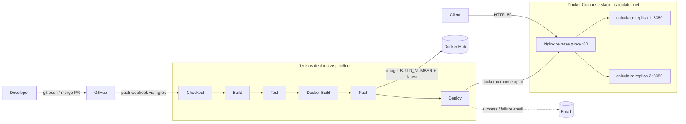
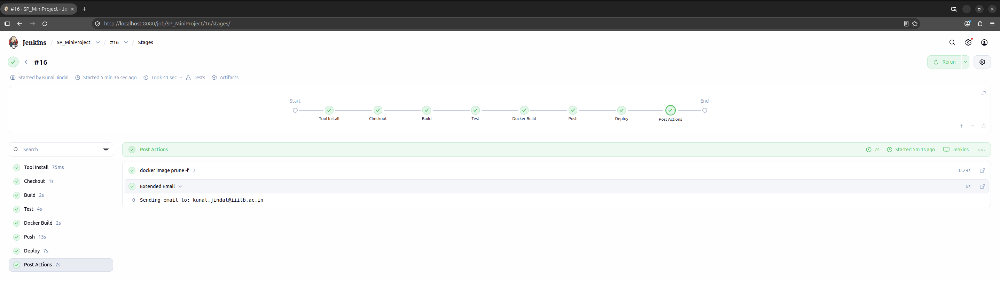
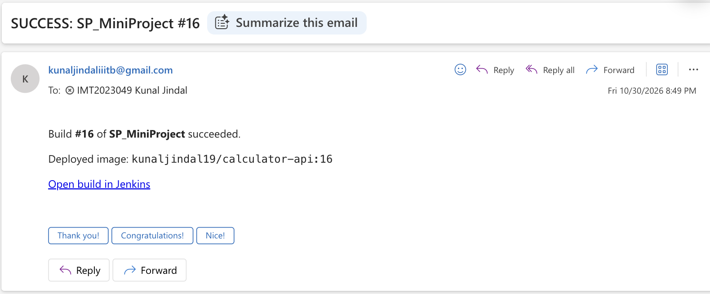
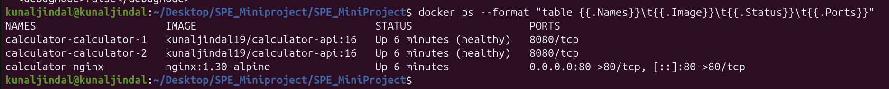
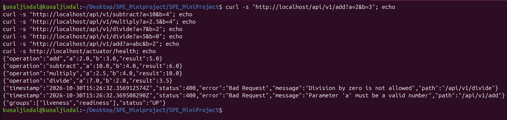

# Calculator REST API — CI/CD Pipeline

A Calculator REST API built with **Spring Boot**, delivered through an automated
DevOps pipeline: **Git/GitHub → Jenkins → Docker → Docker Compose**.

> CSE 816 Software Production Engineering — Mini-Project

- **Docker Hub image:** [kunaljindal19/calculator-api](https://hub.docker.com/r/kunaljindal19/calculator-api)
- **Pipeline:** every push to `main` is built, tested, containerized, pushed and deployed automatically.

## Architecture



## Tech stack

| Area | Tool |
|---|---|
| Language / framework | Java 21, Spring Boot 4 (Spring Web MVC, Actuator) |
| Build | Maven (via the Maven Wrapper `./mvnw`) |
| Testing | JUnit (Jupiter), Spring MockMvc |
| Version control | Git / GitHub |
| CI/CD | Jenkins (declarative pipeline) |
| Containers | Docker, Docker Compose |

## Prerequisites

- JDK 21+
- No separate Maven installation is required — use the bundled wrapper (`./mvnw`).

## Build and run

```bash
# Compile, run tests and package the executable JAR
./mvnw clean package

# Run the application
java -jar target/calculator-api.jar
```

Health check:

```bash
curl http://localhost:8080/actuator/health
# {"groups":["liveness","readiness"],"status":"UP"}
```

## API

Base URL: `http://localhost:8080`

| Operation | Endpoint | Behaviour |
|---|---|---|
| Add | `GET /api/v1/add?a=&b=` | Returns `a + b` |
| Subtract | `GET /api/v1/subtract?a=&b=` | Returns `a - b` |
| Multiply | `GET /api/v1/multiply?a=&b=` | Returns `a * b` |
| Divide | `GET /api/v1/divide?a=&b=` | Returns `a / b`; `b=0` → HTTP 400 |
| Health | `GET /actuator/health` | Spring Boot Actuator health probe (`UP`/`DOWN`) |

### Example requests

```bash
curl "http://localhost:8080/api/v1/add?a=2&b=3"
# {"operation":"add","a":2.0,"b":3.0,"result":5.0}

curl "http://localhost:8080/api/v1/divide?a=7&b=2"
# {"operation":"divide","a":7.0,"b":2.0,"result":3.5}
```

### Errors

Every invalid request returns **HTTP 400** with a structured JSON body:

```bash
curl "http://localhost:8080/api/v1/divide?a=5&b=0"
# {"timestamp":"2026-10-29T17:00:07.794795Z","status":400,"error":"Bad Request",
#  "message":"Division by zero is not allowed","path":"/api/v1/divide"}
```

| Cause | Example | `message` |
|---|---|---|
| Division by zero | `/divide?a=5&b=0` | `Division by zero is not allowed` |
| Missing parameter | `/add?a=2` | `Missing required parameter 'b'` |
| Non-numeric parameter | `/add?a=abc&b=2` | `Parameter 'a' must be a valid number` |
| NaN / Infinity operand | `/subtract?a=NaN&b=1` | `Operands must be finite numbers` |
| Overflow | `/multiply?a=1e308&b=10` | `Result is out of the representable numeric range` |

## Testing

```bash
./mvnw test
```

- **Unit tests** (`CalculatorServiceTest`) — JUnit Jupiter tests for every operation, including division by zero, overflow and invalid operands.
- **Integration tests** (`CalculatorControllerIntegrationTest`) — start the Spring context and call the real endpoints through MockMvc, including error responses and `/actuator/health`.
- **Reports** — JUnit XML in `target/surefire-reports/` (published by Jenkins); JaCoCo coverage in `target/site/jacoco/index.html`.

## Docker

Docker Hub: [`kunaljindal19/calculator-api`](https://hub.docker.com/r/kunaljindal19/calculator-api)

The [Dockerfile](Dockerfile) is a **multi-stage** build:

1. **build** — `maven:3.9-eclipse-temurin-21`: downloads dependencies (cached layer, keyed on `pom.xml`) and packages the JAR.
2. **runtime** — `eclipse-temurin:21-jre-alpine`: contains only the JRE and the JAR, runs as a non-root user and exposes port 8080.

```bash
# Build the image
docker build -t kunaljindal19/calculator-api:latest .

# Run it
docker run -d --name calculator -p 8080:8080 kunaljindal19/calculator-api:latest

# Or pull the published image
docker pull kunaljindal19/calculator-api:latest
```

## Deployment (Docker Compose)

[docker-compose.yml](docker-compose.yml) runs the full stack on a dedicated network (`calculator-net`):

| Service | Image | Details |
|---|---|---|
| `calculator` | `kunaljindal19/calculator-api` | 2 replicas, health check on `/actuator/health`, `restart: unless-stopped`, not exposed to the host |
| `nginx` | `nginx:1.30-alpine` | Reverse proxy on port **80**, load-balances across the replicas ([nginx/nginx.conf](nginx/nginx.conf)), starts only once the API is healthy |

```bash
# Start the whole stack
docker compose up -d

# Status (calculator replicas should be "healthy")
docker compose ps

# Call the API through Nginx
curl -i "http://localhost/api/v1/add?a=2&b=3"     # X-Upstream header shows which replica answered

# Scale the API
docker compose up -d --scale calculator=3

# Stop and remove the stack
docker compose down
```

The image tag can be selected with `IMAGE_TAG` (default `latest`), e.g. `IMAGE_TAG=12 docker compose up -d`.

## CI/CD pipeline

The pipeline is defined in the [Jenkinsfile](Jenkinsfile) (declarative syntax) and is triggered automatically by a
**GitHub push webhook** (`githubPush()` trigger).

| Stage | What it does |
|---|---|
| **Checkout** | Checks out the commit that triggered the build (`checkout scm`) |
| **Build** | `./mvnw clean package -DskipTests`; archives `calculator-api.jar` |
| **Test** | `./mvnw test`; publishes JUnit XML reports; a failing test fails the build |
| **Docker Build** | Builds the image, tagged `kunaljindal19/calculator-api:<BUILD_NUMBER>` and `:latest` |
| **Push** | Logs in to Docker Hub with Jenkins-managed credentials and pushes both tags |
| **Deploy** | `docker compose up -d --wait` with `IMAGE_TAG=<BUILD_NUMBER>`, then checks `/actuator/health` through Nginx |

After every build an **email notification** is sent for success or failure (the console log is attached on failure).

**Re-runnable and idempotent:** the Compose project name is fixed (`name: calculator`), so every run updates the
same stack; `disableConcurrentBuilds()` prevents overlapping deployments; `--wait` fails the build if the new
containers do not become healthy.

### Jenkins setup

| Item | Configuration |
|---|---|
| Plugins | Pipeline, Git, GitHub, JUnit, Credentials Binding, Email Extension |
| JDK tool | `jdk21` (Manage Jenkins → Tools) |
| Docker access | `jenkins` user added to the `docker` group |
| Credentials | `dockerhub-creds` — Docker Hub username + access token (Username with password) |
| Email | Extended E-mail Notification via SMTP; recipients set in *Default Recipients* (no addresses in the repository) |
| Job | Pipeline script from SCM → this repository, branch `*/main`, script path `Jenkinsfile` |
| Webhook | GitHub → Settings → Webhooks → `https://<jenkins-url>/github-webhook/`, push events |

No credentials or secrets are stored in this repository.

## Repository structure

```
.
├── src/main/java/com/spe/calculator/
│   ├── CalculatorApplication.java        # Spring Boot entry point
│   ├── controller/CalculatorController.java
│   ├── service/CalculatorService.java    # arithmetic + validation
│   ├── dto/                              # CalculationResponse, ErrorResponse
│   └── exception/                        # custom exceptions + GlobalExceptionHandler
├── src/main/resources/application.properties
├── src/test/java/com/spe/calculator/     # unit + MockMvc integration tests
├── pom.xml                               # Maven build (Spring Boot, JaCoCo)
├── Dockerfile                            # multi-stage build
├── .dockerignore
├── docker-compose.yml                    # API replicas + Nginx
├── nginx/nginx.conf                      # reverse proxy / load balancer
├── Jenkinsfile                           # declarative CI/CD pipeline
└── docs/screenshots/                     # evidence for the report
```

## Screenshots

**Green Jenkins pipeline run**



**Email notification**



**Running containers (`docker ps`)**



**Sample API responses**


